# Citi Bike Rebalancer

**Which bikes should I move, and where?** Pick a spot in Jersey City or Hoboken, and the app plans the moves that fix the most station imbalance per minute you travel.

### 👉 [Open the app: citi-bike-rebalancer.vercel.app](https://citi-bike-rebalancer.vercel.app)

Nothing to install. It works in any browser, on desktop or phone.

[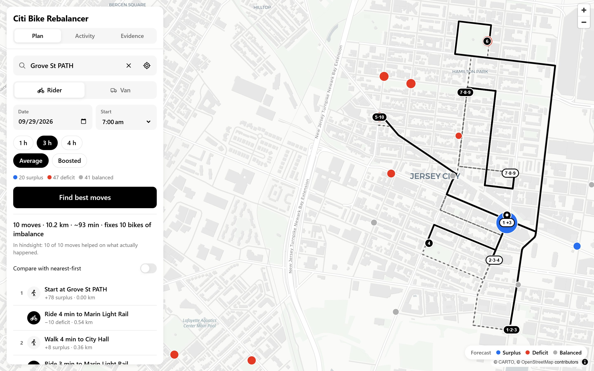](https://citi-bike-rebalancer.vercel.app)

## How to use it

<table>
<tr>
<td width="33%" align="center">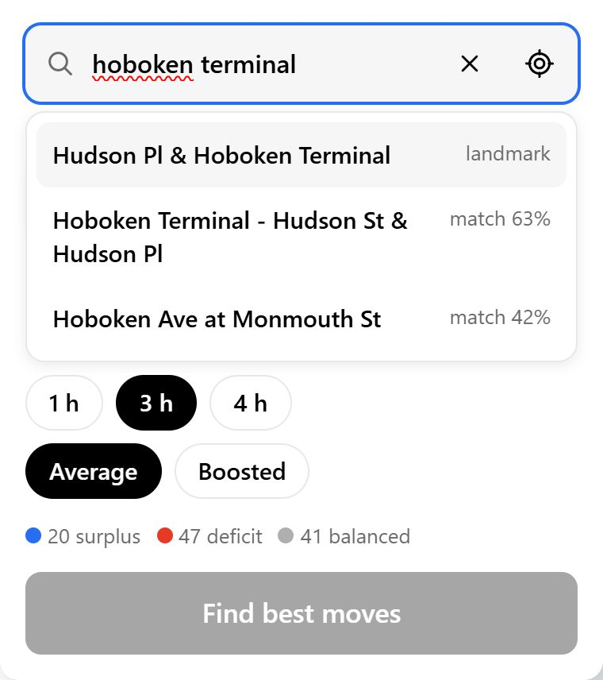<br><b>1. Say where you are</b><br>Search, use GPS, or tap the map</td>
<td width="33%" align="center">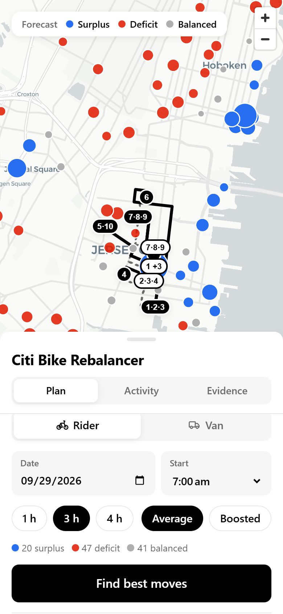<br><b>2. Find best moves</b><br>Follow the numbered route</td>
<td width="33%" align="center">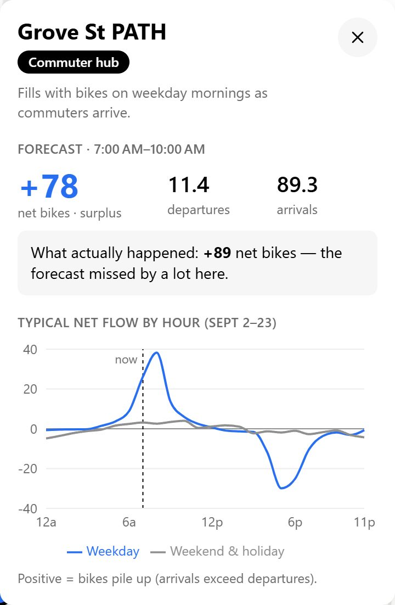<br><b>3. Tap any station</b><br>See its forecast and daily pattern</td>
</tr>
</table>

🔵 **Surplus**: too many bikes, pick one up  🔴 **Deficit**: too few, drop one off  ⚪ **Balanced**

## How it works

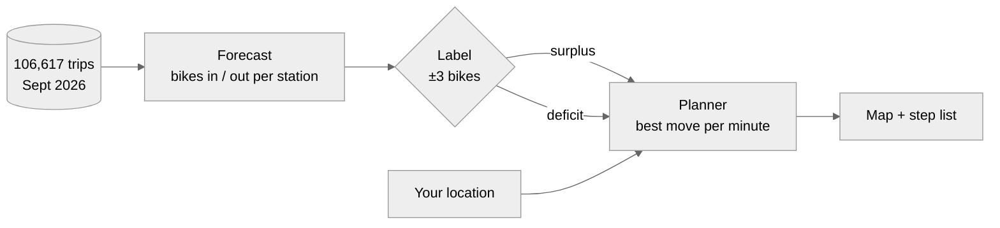

## The AI inside

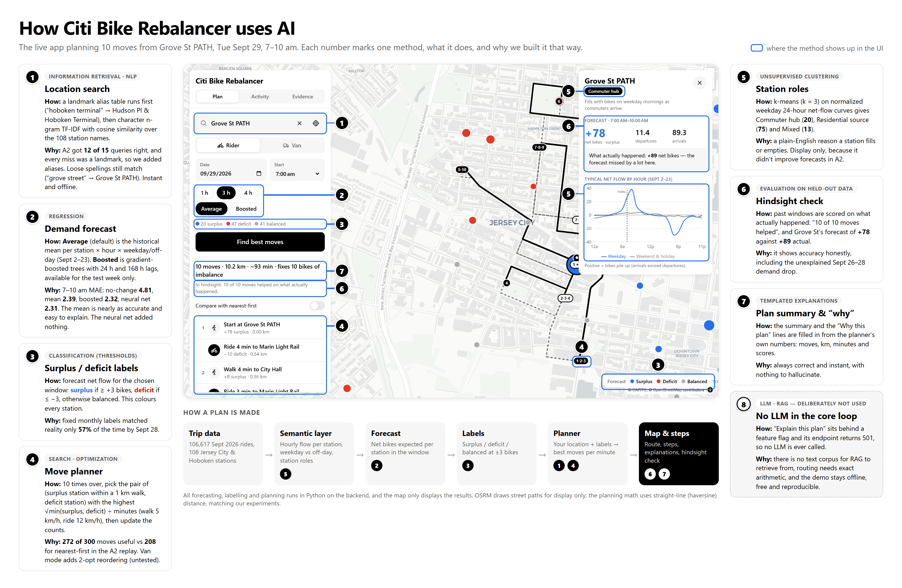

| # | Method | Type |
|---|---|---|
| 1 | Location search | Classical NLP: alias table + TF-IDF |
| 2 | Demand forecast | Regression (historical average, gradient boosting) |
| 3 | Surplus / deficit labels | Threshold classification |
| 4 | Move planner | Greedy search |
| 5 | Station roles | k-means clustering |
| 6 | Hindsight check | Evaluation on held-out data |
| 7 | Plan explanations | Templates (no LLM) |
| 8 | LLM / RAG | Not used, on purpose |

## Results

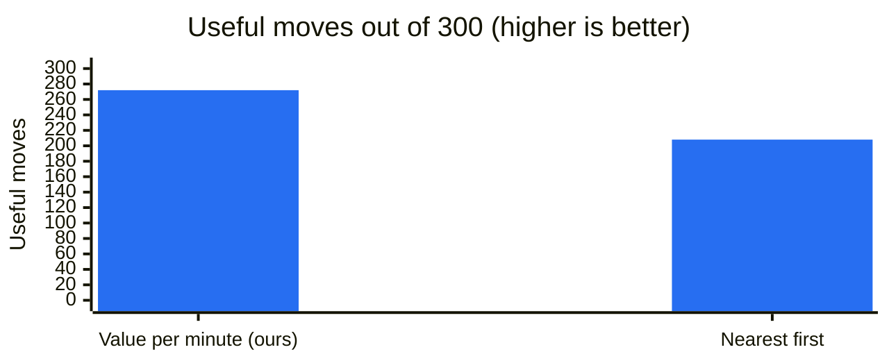

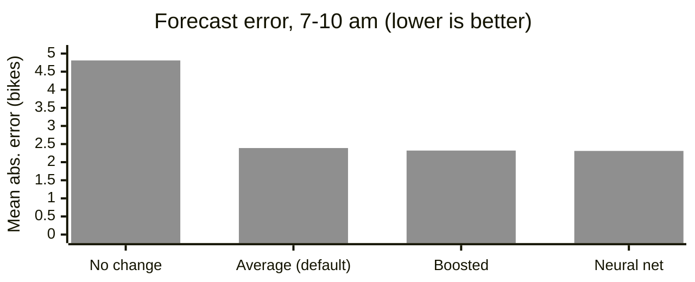

## More screens

<table>
<tr>
<td width="50%">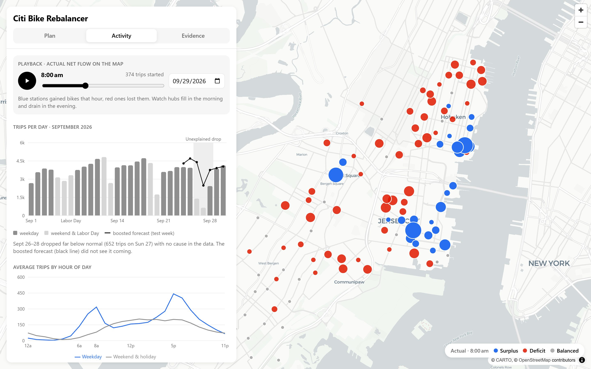<br><b>Activity</b>: daily trips, hourly pattern, and a playback of the whole day</td>
<td width="50%">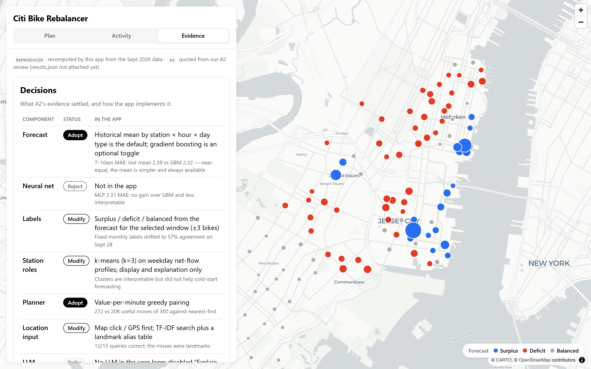<br><b>Evidence</b>: the numbers behind every design choice</td>
</tr>
</table>

## How it's hosted

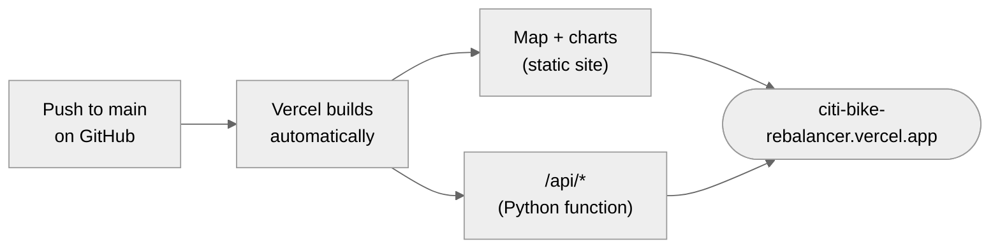

The app is hosted on Vercel and redeploys itself on every push to `main`. The API is a small Python function that reads a pre-built data file (`backend/app/runtime_data/runtime.json.gz`), so the live site needs no database and no setup.

<details>
<summary><b>For developers: rebuild the data or run it on your own machine</b></summary>

Needs Python 3.11+, [uv](https://docs.astral.sh/uv/) and Node 20+. Put the [trip data](https://s3.amazonaws.com/tripdata/index.html) at `data/JC-202609-citibike-tripdata.csv`.

```bash
make setup
```

```bash
make data
```

```bash
make dev
```

`make data` rebuilds the data file; commit it and push to update the live site. `make dev` runs a local copy at http://localhost:5173. No `make`? Use `python tasks.py setup`, `data` and `dev`.

</details>

## Good to know

- Sept 26–28 had a big, unexplained drop in riders. The app shows it rather than hiding it.
- Street paths come from the public OSRM server, which uses car routing. Planning uses straight-line distance.
- Van mode is new and untested. No API keys, no paid services, no LLM calls.
