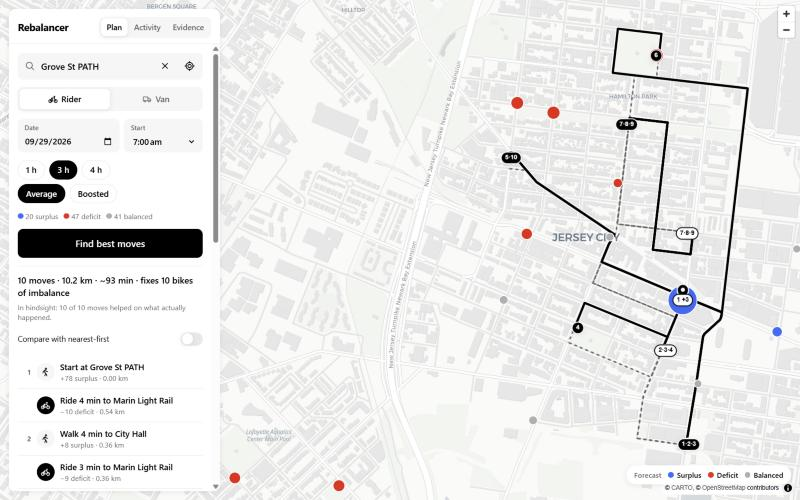

# Citi Bike Rebalancer

CSCI 4150 (Intro to AI) team project. From where you are standing, the app tells you which Citi Bikes to
move and where to take them, so that the most station imbalance gets fixed per minute you travel. It replays
September 2026 Jersey City / Hoboken data: pick any time that month and the app forecasts which stations will
pile up bikes (surplus) or run dry (deficit), then plans your moves.



## Run it

Prerequisites: Python 3.11+, [uv](https://docs.astral.sh/uv/), Node 20.19+ and npm. Put the trip file at
`data/JC-202609-citibike-tripdata.csv` (from [the Citi Bike trip data bucket](https://s3.amazonaws.com/tripdata/index.html)).

```bash
make setup   # backend venv (uv) + frontend packages (npm)
make data    # offline pipeline: CSV -> artifacts/
make dev     # backend on :8000, frontend on http://localhost:5173
```

No `make` (e.g. Windows)? The same targets run as `python tasks.py setup|data|dev|test`.
`make test` runs the backend test suite.

## How it works

```
trips CSV ──► semantic layer ──► forecast ──► planner ──► map
```

1. **Trips** – 106,617 trips starting in Sept 2026 at 108 JC/HB stations
   (`backend/pipeline/build.py`). Departures count every trip; arrivals drop the 331 trips with no end
   station and the 274 that end in Manhattan.
2. **Semantic layer** – an hourly station panel (departures, arrivals, net = arrivals − departures, day type
   where weekends and Labor Day are "off-days") and station *roles* from k-means (k = 3) on normalized weekday
   net-flow profiles: Commuter hub / Residential source / Mixed. Roles are for display and explanation only.
3. **Forecast** (`app/forecast.py`) – the default is the historical mean by station × hour × day type
   (Sept 2–23). A gradient-boosting toggle ("Boosted") is available for the Sept 24–30 test week. Each station
   is labelled for the selected window: surplus if forecast net ≥ +3, deficit if ≤ −3, otherwise balanced.
4. **Planner** (`app/planner.py`) – value-per-minute greedy pairing. Each move picks the surplus station
   within a 1 km walk and the deficit station that maximize √min(surplus, deficit) / minutes, at 5 km/h
   walking and 12 km/h riding (haversine), plus 1 minute per move. Nearest-first is shown for comparison.
   Van mode (capacity 20, 2-opt reordering) is new and **untested**.
5. **Map** (`frontend/`) – React + MapLibre on CARTO basemaps. Street paths come from the public OSRM demo
   server; on any failure or a 1.5 s timeout the route falls back to straight dashed lines. Planning math
   never uses OSRM.

All planning, forecasting and labelling happens in Python; the frontend only displays it.

The **Evidence** tab shows the numbers behind each design decision. The pipeline recomputes the forecaster
MAE table (zero 4.81 / historical mean 2.39 / GBM 2.32) and the planner replay (272 vs 208 useful moves of
300), and the tests assert both.

## Notes and limits

- **Sept 26–28 had a large, unexplained demand drop** (652 trips on Sun Sept 27). The app shows it on the
  Activity tab instead of hiding it, and the forecasts miss it.
- The OSRM demo server ignores the profile in the URL and returns car routes, so drawn paths follow car
  routing (one-way streets) even for walking and riding legs.
- No LLM is used. `POST /api/explain` is a stub that returns 501. The "Explain this plan" button only appears
  when the frontend is started with `VITE_ENABLE_EXPLAIN=true`.
- No API keys, paid services or telemetry.

## Layout

```
backend/
  pipeline/build.py      offline: CSV -> artifacts/*.parquet|json
  pipeline/evidence.py   evidence.json for the Evidence tab
  app/main.py            FastAPI
  app/forecast.py        historical mean + GBM lookups
  app/planner.py         value-per-minute, nearest-first, van mode
  app/replay.py          the A2 planner replay (used by tests and evidence)
  app/grounding.py       TF-IDF + alias table geocoder
  app/aliases.json       landmark -> station_id
  tests/
frontend/src/            React app (components, api, styles)
research/                A2 experiments script (experiments.py)
artifacts/               generated by `make data`, gitignored
```

## Data

Trip data comes from [Citi Bike's public trip data](https://s3.amazonaws.com/tripdata/index.html).
